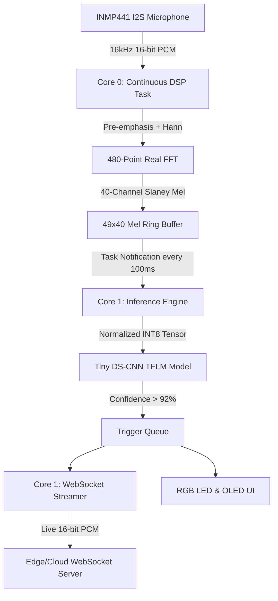

# Pluto: Private, Fast, Lightweight Edge Device

An edge AI wake-word detection and real-time streaming firmware built for the **ESP32-S3** microcontroller using **ESP-IDF** and **TensorFlow Lite for Microcontrollers (TFLM)**.

Pluto runs continuous on-device keyword spotting ("Hey Pluto") entirely offline with zero cloud dependency for detection, ensuring total privacy. Upon detection, it seamlessly establishes a real-time WebSocket connection to stream live command audio to an edge/cloud server.

---

## Key Highlights

- **Edge Keyword Spotting**: Continuous keyword detection running locally on ESP32-S3 (Dual-core Xtensa LX7 @ 240 MHz).
- **Dual-Core Architecture**:
  - **Core 0 (DSP Engine)**: Real-time 16 kHz I2S audio ingestion, 1-second sliding audio history, pre-emphasis filtering, Hann windowing, 480-point FFT, and 40-band Mel-filterbank extraction into a circular ring buffer.
  - **Core 1 (Machine Learning & Networking)**: TFLite Micro INT8 inference (Tiny DS-CNN architecture), FreeRTOS event handling, Wi-Fi connectivity, and real-time WebSocket audio streaming.
- **Ultra-Low Latency & Memory Efficiency**: Sub-100ms inference turnaround using INT8 quantization and hardware-accelerated vector DSP routines (`esp-nn`).
- **Real-Time WebSocket Uplink**: Once triggered (>92% confidence), streams 16-bit PCM audio chunks over WebSocket to cloud/edge infrastructure in real time.
- **Embedded Web Diagnostics**: Integrated HTTP server with SPIFFS file storage for downloading raw audio captures and verification WAV files.
- **Visual Feedback**: Real-time feedback via SSD1306 I2C OLED display and addressable RGB status LEDs.

---

## System Architecture



---

## Directory Structure

```text
├── main/
│   ├── main.cpp                  # Application lifecycle and task orchestration
│   ├── CMakeLists.txt            # Main component build rules
│   ├── idf_component.yml         # ESP component manager manifest
│   ├── ws_streamer.cpp/.hpp      # Real-time WebSocket streaming pipeline
│   ├── test_audio.h              # Test audio vectors for verification
│   ├── dsp/                      # Signal processing pipeline
│   │   ├── continuous_dsp.cpp/.hpp
│   │   ├── fft480.cpp/.hpp
│   │   └── mel_filterbank.cpp/.hpp
│   ├── ml/                       # Machine Learning / TFLite Micro inference
│   │   ├── inference_engine.cpp/.hpp
│   │   └── wake_word_model.cpp/.hpp
│   ├── net/                      # Network managers
│   │   ├── wifi_manager.cpp/.hpp
│   │   ├── web_server.cpp/.hpp
│   │   ├── edge_client.cpp/.hpp
│   │   └── sntp_manager.cpp/.hpp
│   ├── ui/                       # User feedback (OLED and RGB LED)
│   │   ├── oled_display.cpp/.hpp
│   │   ├── rgb_led.cpp/.hpp
│   │   └── font5x7.h
│   └── diagnostics/              # Pipeline profiling and diagnostics
│       └── pipeline_diagnostic.cpp/.hpp
├── partition_table/              # Custom partition layout definitions
├── partitions.csv                # Custom partition table (8MB Flash, SPIFFS)
├── sdkconfig.defaults            # ESP-IDF default build configurations
├── tools/                        # Python scripts for model inspection & preprocessing verification
│   ├── inspect_tflite.py
│   ├── reference_preprocess.py
│   └── validate_preprocess.py
├── test_arena/                   # Offline model benchmarking & arena allocation tests
├── dsp_pipeline_documentation.md # Detailed breakdown of DSP math & audio pipeline
└── websocket_pipeline_documentation.md # Detailed WebSocket handshake & protocol documentation
```

---

## Hardware Configuration

| Component | Interface | ESP32-S3 Pin | Notes |
| :--- | :--- | :--- | :--- |
| **INMP441 (BCLK)** | I2S0 | GPIO 4 | Audio clock |
| **INMP441 (WS)** | I2S0 | GPIO 5 | Audio word select |
| **INMP441 (SD/DIN)** | I2S0 | GPIO 6 | Audio serial data |
| **OLED (SDA)** | I2C0 | GPIO 17 | SSD1306 Display |
| **OLED (SCL)** | I2C0 | GPIO 18 | SSD1306 Display |
| **RGB LED** | GPIO / RMT | GPIO 48 | Status Indicator |

---

## Build & Flash

### Prerequisites
- ESP-IDF **v5.0+** (tested with v5.3 / v5.5)
- Python 3.8+

### Setup & Build
1. Set up the ESP-IDF environment:
   ```bash
   get-idf
   ```
2. Set the target to ESP32-S3:
   ```bash
   idf.py set-target esp32s3
   ```
3. Build the firmware:
   ```bash
   idf.py build
   ```
4. Flash to device and monitor logs:
   ```bash
   idf.py -p <PORT> flash monitor
   ```

---

## License

This project is licensed under the Apache 2.0 License.
